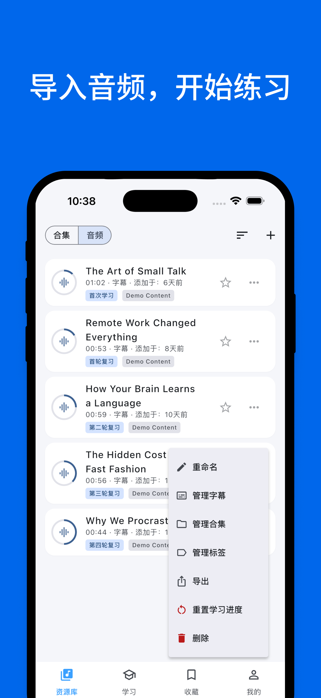
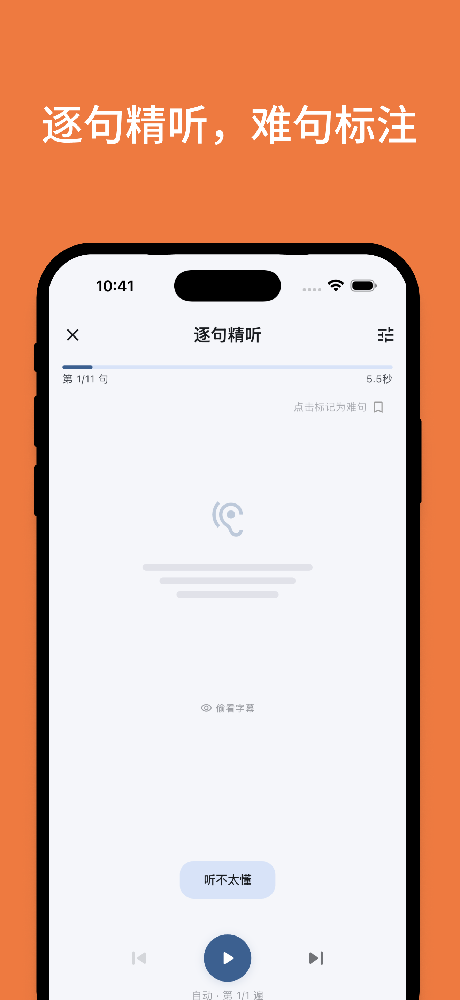
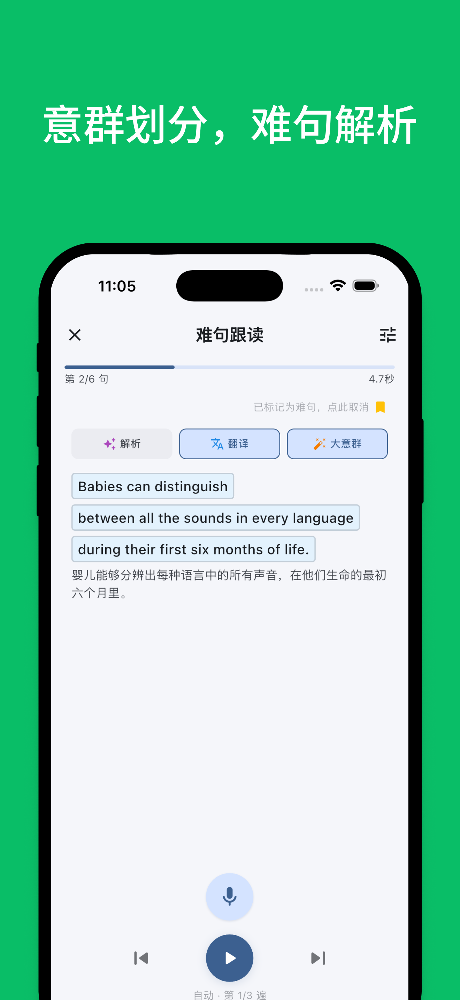
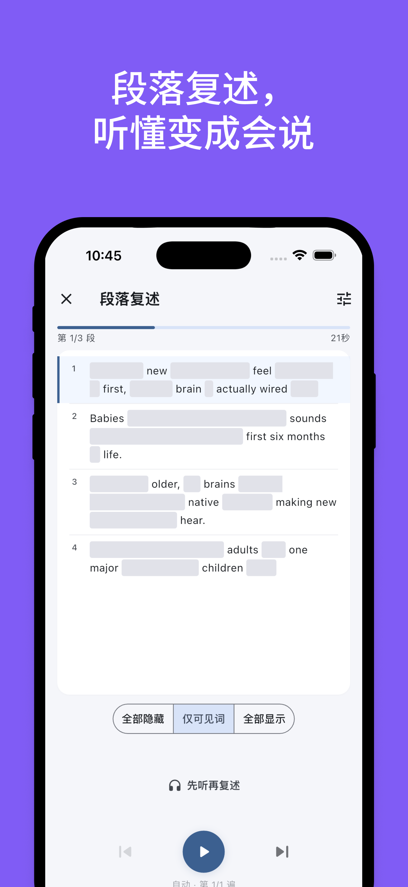
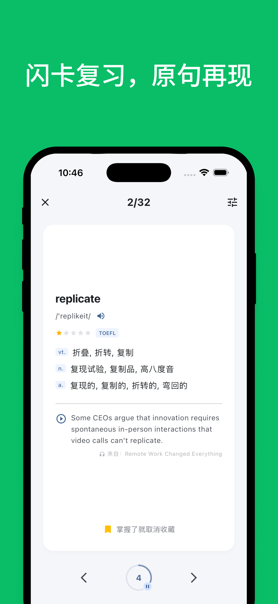

<div align="center">
  

  <h1>Echo Loop — Self-hosted Edition</h1>

  <p><strong>An English listening &amp; speaking trainer that runs without anyone's backend.</strong></p>

  <p>No analytics · No paywall · Bring your own OpenAI key · Vietnamese UI</p>

  <p>
    <a href="./LICENSE"></a>
    
    <a href="https://github.com/echo-loop/Echo-Loop"></a>
  </p>
</div>

---

This is a personal fork of **[echo-loop/Echo-Loop](https://github.com/echo-loop/Echo-Loop)**, an open-source Flutter app
that drives you through a structured listen → shadow → retell → spaced-review loop.

The upstream app depends on the original author's servers for sign-in, subscriptions, AI features and transcription.
This fork removes all of that: every AI request goes **directly from your device to OpenAI (or any
OpenAI-compatible endpoint) using an API key you enter in the app**, and nothing is sent to the original author.

> All learning features belong to the upstream project. Credit goes to the Echo Loop authors.
> This fork only changes where data goes and who pays for AI.

## 📱 Screenshots

<table>
  <tr>
    <td align="center"><br/><sub>Import audio</sub></td>
    <td align="center"><br/><sub>Intensive listening</sub></td>
    <td align="center"><br/><sub>Sense groups &amp; AI analysis</sub></td>
    <td align="center"><br/><sub>Retelling</sub></td>
    <td align="center"><br/><sub>Flashcard review</sub></td>
  </tr>
</table>

<sub>Screenshots are from the upstream app (Chinese UI).</sub>

## ✨ Features (from upstream)

- **Auto-driven learning loop**: intensive listening → shadowing → blind listening → retelling, then 7 spaced
  reviews from 6 hours to 28 days.
- **Sense-group splitting** of long sentences.
- **Saved hard sentences** and **flashcards reviewed in their original context**.
- **AI translation, sentence analysis, AI dictionary, AI tutor chat, AI retell evaluation**.
- **Local audio import**, existing subtitle import (SRT, …), or AI transcription.
- Podcasts via RSS, resume where you left off, learning statistics.

## 🔧 What this fork changes

| Area | Upstream | This fork |
|---|---|---|
| Analytics | PostHog (with iOS session replay), Firebase Analytics, Umeng | **Removed.** Events are only logged locally (`LogOnlyChannel`) |
| Android permissions | `AD_ID`, `BILLING` | Removed |
| Payments / Pro | RevenueCat, Paddle, StoreKit | Removed. **All Pro features unlocked** |
| AI features (translate, analyze, dictionary, sense groups, chat, retell review) | Author's backend | **Direct `chat/completions` call with your own API key** |
| Cloud transcription (AI subtitles) | Upload to the author's R2 + backend | **Direct `audio/transcriptions` (Whisper) call with your key** |
| Sign-in | Author's Supabase | **Guest mode by default** (account UI hidden). Can be re-enabled with your own Supabase |
| Remote config, featured podcasts, community collections, update check, region detection, Baidu Netdisk | Author's backend | Disabled (`API_BASE_URL` empty). Local defaults are used |
| Podcast subscriptions | Required sign-in | No sign-in. Search via iTunes Search API, RSS read directly |
| Languages | English, Chinese | **+ Vietnamese** (UI and native language for translations) |
| Package / app name | `app.echoloop` / "Echo Loop" | `app.echoloop.selfhost` / "Study Loop". Installs side by side with the official app |
| Signing | Author's keystore | Your own release keystore (never committed) |

### Remaining outbound connections

None of these carry personal data; they only see your IP address.

- `cdn.echo-loop.top`: public static files (on-device ASR/TTS models, offline EN→ZH dictionary, pronunciation data).
  You can mirror them yourself (see [Self-hosting the model CDN](#self-hosting-the-model-cdn)).
- Web dictionaries (Cambridge, Oxford, …), opened in a WebView only when you pick them.
- iTunes Search API, when searching podcasts.
- The AI base URL you configure (default `api.openai.com`), only when you use an AI feature.

## 🔑 Bring your own OpenAI key

Open **Profile → Settings → AI Settings**:

1. **API key**: `sk-...`. Stored only in `flutter_secure_storage` (Android Keystore). It is never written to
   SharedPreferences, logs, in-app backups, or build-time defines.
2. **Base URL**: defaults to `https://api.openai.com/v1`. Any OpenAI-compatible service works (OpenRouter, a local
   server, …). Plain `http://` is only allowed for localhost / LAN addresses.
3. **Model**: defaults to `gpt-4.1-mini`. You can type any model name.
4. Tap **Test connection**, then **Save**.

Transcription uses `whisper-1` on the same base URL and key, so your provider must support `audio/transcriptions`.

If an AI feature is used without a key, the app shows a dialog that links straight to AI Settings.

> **Note on reasoning models:** the chat client always sends `temperature`. Some reasoning models (e.g. the
> `gpt-5*` family) may reject it with HTTP 400. Non-reasoning models such as `gpt-4.1-mini` are recommended;
> none of the app's features need reasoning.

### Cost

You pay OpenAI directly, at their standard per-token prices. With `gpt-4.1-mini`, sentence-level features
(translation, analysis, dictionary lookups) cost a fraction of a cent each. Whisper is billed per minute of audio.

## 🛠️ Build

Requirements: Flutter 3.41.5 (stable), Android SDK (via Android Studio), JDK 17.

### Setting up on a new machine

1. Install [Android Studio](https://developer.android.com/studio). In **SDK Manager**, install an Android SDK
   platform, **Android SDK Command-line Tools** and **Platform-Tools**. Create an emulator in **Device Manager**
   if you want one.
2. Install JDK 17 (Android Studio's bundled JDK works: `flutter config --jdk-dir "<Android Studio>/Contents/jbr"`
   on macOS).
3. Install [Flutter](https://docs.flutter.dev/get-started/install) 3.41.5, add it to `PATH`, then run
   `flutter doctor --android-licenses` and `flutter doctor` until the Android section is green.
4. Clone and restore secrets:
   ```bash
   git clone https://github.com/LampardNguyen/study-loop.git
   cd study-loop
   # copy your backed-up keystore and key.properties (they are not in git)
   cp /path/to/backup/selfhost-release.jks android/app/
   cp /path/to/backup/key.properties android/
   ```
   Without them, `--flavor prod` cannot be signed with your key, and the build will **not** install over the
   copy already on your phones.
5. Build (below). If the latest installed build number was N, use `--build-number=N+1`
   (check it on a phone with `adb shell dumpsys package app.echoloop.selfhost | grep versionCode`).

### Build commands

```bash
flutter pub get
dart run build_runner build --delete-conflicting-outputs
flutter build apk --release --flavor prod
```

The APK is written to `build/app/outputs/flutter-apk/app-prod-release.apk`.

- `--flavor prod`: package `app.echoloop.selfhost`, signed with your release keystore.
- `--flavor dev`: package `app.echoloop.dev`, signed with the debug key.
- To install an update over an existing build, `versionCode` must increase:
  `flutter build apk --release --flavor prod --build-number=2` (then 3, 4, …).

### Release signing

Create your own keystore and `android/key.properties`:

```bash
keytool -genkey -v -keystore android/app/selfhost-release.jks -keyalg RSA -keysize 2048 -validity 10000 -alias selfhost
```

```properties
# android/key.properties
storePassword=...
keyPassword=...
keyAlias=selfhost
storeFile=selfhost-release.jks
```

Both files are in `.gitignore`. **Back them up:** if you lose the keystore you cannot install updates over the
existing app without uninstalling it and losing your data.

### Optional build-time variables

Pass with `--dart-define=...` or `--dart-define-from-file=.prod.env` (`.prod.env` is gitignored, see `.dev.env.template`).

| Variable | Purpose |
|---|---|
| `MODEL_CDN_BASE_URL` | Your own mirror for models and dictionaries (default: upstream CDN) |
| `SUPABASE_URL`, `SUPABASE_PUBLISHABLE_KEY`, `GOOGLE_WEB_CLIENT_ID` | Re-enable sign-in with your own Supabase project |
| `API_BASE_URL` | **Leave empty.** Only set it if you run a backend compatible with the upstream server |

The OpenAI key is **never** a build variable. It is entered in the app only.

### Optional: sign-in with your own Supabase

1. Create a Supabase project and enable the providers you want (Email, Google, Apple).
2. Put `SUPABASE_URL` and `SUPABASE_PUBLISHABLE_KEY` (plus `GOOGLE_WEB_CLIENT_ID` for Google) into `.prod.env`.
3. Rebuild. The **Account** section reappears. Sign-in is still **not** required for AI features.

### Self-hosting the model CDN

1. Download the files the app needs from `https://cdn.echo-loop.top/...`, keeping the same paths
   (see `lib/services/dictionary/dictionary_catalog.dart`, `scripts/piper_tts_models.manifest.txt`,
   `scripts/upload_asr_models_to_r2.sh`).
2. Upload them to R2 / S3 / GitHub Pages with the same directory layout.
3. Build with `--dart-define=MODEL_CDN_BASE_URL=https://your-cdn.example`.

## 🧪 Tests

```bash
flutter analyze
flutter test
```

Known baseline issues inherited from upstream: 3 analyzer errors in `integration_test/kokoro_tts_test.dart`
(outdated API), and a few flaky retell timing tests.

## ⚠️ Known limitations

- Cloud transcription is limited by Whisper to 25 MB per file. Longer audio is compressed first; if it is still
  too large, the app reports an error.
- On-device speech recognition is still hidden by upstream (quality not yet stable).
- No offline English→Vietnamese dictionary. With Vietnamese as native language, the app uses the AI dictionary
  or Cambridge English–Vietnamese.
- The Vietnamese translation was machine-assisted; some strings may read unnaturally.
- Only Android has been built and tested for this fork. iOS / macOS / Windows code is unchanged from upstream
  apart from the removals above.

## 📂 Project notes

- [`SELFHOST_TASKS.md`](./SELFHOST_TASKS.md): task log of this fork's changes (Vietnamese).
- [`docs/selfhost/`](./docs/selfhost/): design notes and the AI endpoint mapping for this fork.
- `CLAUDE.md`, `AGENTS.md`, `PLAN.md`, `TASKS.md`, `docs/*`: upstream development docs (mostly Chinese), kept for
  reference and to make merging upstream changes easier.

## 📜 License

Licensed under **AGPL-3.0**, the same as upstream (see [`LICENSE`](./LICENSE)). Modifications are summarized in [`NOTICE`](./NOTICE).
If you distribute builds of this app to others, you must make your modified source available under the AGPL.

Original project © the [Echo Loop](https://github.com/echo-loop/Echo-Loop) authors.
"Echo Loop" and its icon belong to the upstream project. This fork is not affiliated with or endorsed by them.
